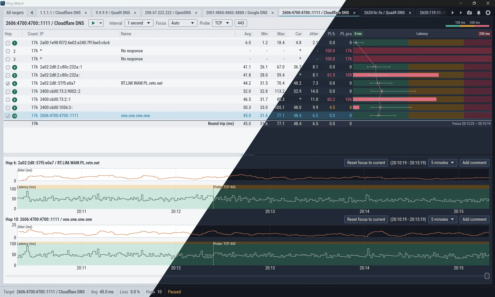

<!--suppress ALL -->
<p align="center">
    
</p>
<p align="center">
    <a href="https://doc.rust-lang.org/edition-guide/rust-2024/">
        
    </a>
    <a href="https://crates.io/crates/eframe/0.37.0">
        
    </a>
    <a href="https://crates.io/crates/egui_plot/0.38.0">
        
    </a>
    <a href="https://crates.io/crates/rusqlite/0.43.0">
        
    </a>
    <a href="https://crates.io/crates/windows/0.62.2">
        
    </a>
    <a href="https://crates.io/crates/tray-icon/0.26.1">
        
    </a>
</p>
<p align="center">
    <a href="https://github.com/iRingil/ping-watch/actions/workflows/dependabot/dependabot-updates">
        
    </a>
    <a href="https://github.com/iRingil/ping-watch/actions/workflows/github-code-scanning/codeql">
        
    </a>
    <a href="https://github.com/iRingil/ping-watch/actions/workflows/lint.yml">
        
    </a>
    <a href="https://github.com/iRingil/ping-watch/actions/workflows/test.yml">
        
    </a>
    <a href="https://github.com/iRingil/ping-watch/actions/workflows/test.yml">
        
    </a>
</p>
<p align="center">
    <a href="https://github.com/iRingil/ping-watch/releases/latest">
        
    </a>
    <a href="LICENSE.md">
        
    </a>
    <a href="https://github.com/rust-lang/rust-clippy">
        
    </a>
    <a href="https://deepwiki.com/iRingil/ping-watch">
        
    </a>
</p>

**Ping Watch** keeps an eye on your connection: it traces the route to the sites and servers you choose and shows,
hop by hop, where the delays and the lost packets are.

Enter an address, and Ping Watch probes every router on the way to it, again and again, so a slow or dropping hop
stands out at once. It keeps the history, so you can look back at what happened while you were away.

<p align="center">
    
</p>

## Features

- **Hop by hop.** Each router on the route gets a row: its address and name, the average, best, worst and current
  latency, the jitter and the packet loss in percent and in lost probes, with a bar that shows the spread over green,
  amber and red zones (their limits are yours to set). Hover a column title to see what it means. Columns can be made
  wider or narrower, and shown or hidden with a right click on the header or in Settings → Columns.
- **Long routes fold.** The hop limit (Settings → Tracing) keeps the table short: the first hop, a row telling how
  many are hidden, then the last hops. Tracing itself always goes up to 40 hops.
- **ICMP or TCP.** Hops are probed with pings, or, for a server that ignores pings or a network whose firewall drops
  them, with TCP connection requests to a port of your choice (443 by default), over IPv4 and IPv6. TCP needs no
  packet driver, only administrator rights and a few firewall rules: choosing TCP without the rights asks whether to
  restart Ping Watch as administrator, and the restarted app adds the rules to Windows Firewall by itself (see
  [TCP probes and firewalls](#tcp-probes-and-firewalls)). The whole app then runs as administrator. A target traced
  by TCP before asks for these rights as soon as Ping Watch starts without them; said no to, it stays stopped (never
  traced by ICMP in its place) and its tab and All targets tell why. In a Windows account without administrator
  rights, TCP isn't available. An open port answers with a full connection, which Ping Watch resets at once: a
  server may log these connections, and strict rules (fail2ban and the like) may count them as attempts.
- **History.** Every probe is stored on this PC. Tick hops in the table (or double-click their rows) to chart their
  latency, jitter and loss one under another, over the last minute to the last seven days; a slider goes back in
  time, and comments can be pinned to a moment; a change of probe is marked on the chart by itself. Reset and
  restart (Ctrl+R) starts a target over and deletes its history: chart, comments and alert marks.
- **Several targets.** Each target has its own tab. "All targets" shows them side by side, each with its latency bar,
  and charts the ones you tick, all over the same period.
- **Alerts.** Rules for loss and latency, for one target or all of them, such as "loss above 5 % for two minutes".
  Windows shows a notification when a rule fires and another when the connection is fine again; every alert is kept
  in a log and marked on the timeline.
- **Snapshots.** One click saves the shown target, or All targets, as a single HTML page: the hop table, the
  latency and loss chart and the alerts of the period, ready to send to your provider or to print.
- **IPv4 and IPv6**, host names or addresses, with a list of public DNS servers to start from.
- **In the background.** The close button can hide Ping Watch to the notification area, where it keeps tracing, and
  it can start with Windows, hidden there.
- **Five languages.** English, Russian, German, French and Spanish.
- **Light and dark themes**, or the one Windows uses.
- **Normal or portable installation**: for one Windows user, or into any folder such as a USB stick.

## Installation

Download the latest version from [Releases](https://github.com/iRingil/ping-watch/releases/latest). It runs on
64-bit Windows 10 and 11.

- `PingWatch-<version>-setup.exe` is the installer. It needs no administrator rights and offers two types:
  - **Normal**: installs into `%LOCALAPPDATA%\Programs\Ping Watch` for the current Windows user, with a Start menu
    shortcut and an entry in Installed apps to uninstall it.
  - **Portable**: copies the app into any folder, without shortcuts or an uninstaller.
- `PingWatch-<version>-portable.zip` is the portable copy: unpack it anywhere and run `PingWatch.exe`.

The app is not code-signed yet, so Windows SmartScreen may warn about it: click **More info → Run anyway**. To be
sure the file is the one GitHub built, compare its SHA-256 with `SHA256SUMS.txt` of the release, or check its build
provenance with `gh attestation verify PingWatch-<version>-setup.exe -R iRingil/ping-watch`.

### TCP probes and firewalls

The answers to TCP probes come to Ping Watch as unasked-for incoming traffic, which a firewall on the PC drops
without a rule: the hops then show no response (their answers are ICMP errors), or the target does too. Ping Watch
notices and says "A firewall may be blocking the answers to TCP probes" in the status bar, with an **Allow** button.
The rules that let the answers in:

- incoming ICMPv4, types 3 (destination unreachable) and 11 (time exceeded), for all programs;
- incoming ICMPv6, types 1 (destination unreachable) and 3 (time exceeded), for all programs;
- incoming TCP for `PingWatch.exe`.

**Allow** adds them to Windows Firewall, if that is the one in use (group "Ping Watch" in Windows Defender Firewall
with Advanced Security), as does the restart as administrator that choosing TCP offers. Another firewall needs the
same rules added by hand; the window that Allow opens lists them with the program's path. The ICMP rules are for
all programs because Windows doesn't apply a program's rule to these messages.

### Where the app keeps its files

|                                                    | Normal installation                                          | Portable copy                                 |
|----------------------------------------------------|--------------------------------------------------------------|-----------------------------------------------|
| Probe history, settings, targets, window and tabs  | `%LOCALAPPDATA%\Ping Watch\history.sqlite`                   | `userdata\history.sqlite` in the app's folder |
| Start with Windows, when turned on in the settings | `HKCU\Software\Microsoft\Windows\CurrentVersion\Run`         | the same                                      |
| ...with administrator rights, when turned on       | the task `Ping Watch (<user>)` in Task Scheduler             | the same                                      |
| Firewall rules for TCP probes, when you allow them | group "Ping Watch" in Windows Firewall                       | the same                                      |
| Name and icon of the app's notifications           | `HKCU\Software\Classes\AppUserModelId\iRingil.PingWatch`     | the same                                      |
| The icon file those notifications show             | `%LOCALAPPDATA%\Ping Watch\notification-icon.png`            | `userdata\notification-icon.png`              |

The history keeps the last seven days by default (Settings → Tracing → Keep history for). A portable copy is a folder
with `portable.txt` next to `PingWatch.exe`: delete that file, and the copy keeps its data in the user profile
instead.

A portable copy leaves the same things in Windows as a normal installation. Starting with Windows is a value under
`Run` for the current user (not a shortcut in the Startup folder) or, with "With administrator rights" ticked, a
Task Scheduler task that starts the app with them at sign-in, so that Windows asks for them once and not every
time. Windows shows notifications under the app's name and icon only when they are registered under
`AppUserModelId`. The firewall rules are there only if you had them added.

To remove a portable copy, click **Remove traces and quit** in Settings → General, then delete the folder. It
removes all of the above and the app's entry among the notification area icons; where the task or the firewall
rules exist, Windows asks for administrator rights. Uninstalling a normal installation does the same and asks
whether to delete the history and the settings as well.

## Privacy

Ping Watch has no accounts, telemetry, ads or analytics. It sends only what tracing needs, and a daily check for
updates that you can turn off:

- **ICMP echo requests** (pings) to the targets you enter, sent with a TTL of 1, 2, 3 and so on up to the target, so
  that each router on the way answers the one that expires at it. While a target doesn't answer, the TTLs up to three
  past the last answering router are probed every interval and the farther ones (up to 40) one per interval in turn.
- **TCP connection requests** (SYN) instead, for the targets you set to TCP probes: to the port you choose, with the
  same TTLs. Each is closed (reset) once answered; no data is sent. To catch the answers, Ping Watch reads the headers
  of the IP packets this PC receives while a TCP trace runs (a raw socket, the reason it needs administrator rights);
  it looks only for answers to its own probes and stores nothing else.
- **DNS lookups**: the address of a target given by name, and the names of the routers on the route (reverse DNS;
  Settings → Tracing → Hop names turns these off).
- **GitHub** (`api.github.com`): once a day, a request for the latest release of this repository, to tell you when a
  new version is out (Settings → General → Updates turns it off), and when you click About → Check for updates.

The history, the settings and the list of targets stay on this PC, in the file listed above.

## How releases are built

Every release is built from this repository by [GitHub Actions](.github/workflows/build.yml) and published by the
[Release workflow](.github/workflows/release.yml) from the files of a tested build, after a scan by VirusTotal (the release notes link to its reports). The app's network use is described
in [Privacy](#privacy).

## Building from source

With Rust (stable, edition 2024) on Windows, from the repository root:

```shell
cargo run                                             # run from source
cargo run -- 1.1.1.1 github.com                       # open a tab per target
cargo fmt                                             # format
cargo clippy --all-targets                            # lint
cargo test                                            # tests
cargo audit                                           # advisories (cargo install cargo-audit)
infrastructure\inno\build.cmd                         # release build, installer and portable zip (needs Inno Setup 7
                                                      # and cargo install cargo-about --locked --features cli)
```

## License

Ping Watch is released under the [PolyForm Noncommercial License 1.0.0](LICENSE.md): you may use, change and share it
for any noncommercial purpose. It is built with these third-party components:

- [egui, eframe, egui_extras](https://github.com/emilk/egui) and [egui_plot](https://github.com/emilk/egui_plot):
  MIT or Apache-2.0
- [rusqlite](https://github.com/rusqlite/rusqlite): MIT; [SQLite](https://sqlite.org): public domain
- [windows, windows-registry](https://github.com/microsoft/windows-rs): MIT or Apache-2.0
- [tray-icon](https://github.com/tauri-apps/tray-icon): MIT or Apache-2.0
- [socket2](https://github.com/rust-lang/socket2): MIT or Apache-2.0
- [dns-lookup](https://github.com/keeperofdakeys/dns-lookup), [chrono](https://github.com/chronotope/chrono),
  [ctrlc](https://github.com/Detegr/rust-ctrlc): MIT or Apache-2.0
- [tauri-winrt-notification](https://github.com/tauri-apps/winrt-notification): MIT or Apache-2.0
- [ureq](https://github.com/algesten/ureq), [serde_json](https://github.com/serde-rs/json): MIT or Apache-2.0
- [anyhow, thiserror](https://github.com/dtolnay), [log, env_logger](https://github.com/rust-lang/log):
  MIT or Apache-2.0
- [Roboto Condensed](https://github.com/googlefonts/roboto-classic) font: SIL Open Font License 1.1
- [Rust](https://www.rust-lang.org) standard library: MIT or Apache-2.0

These are the main ones. The complete list, every crate in the build with its license text, is in `THIRD-PARTY.html`
next to `PingWatch.exe` (Settings → About → Third-party licenses), written at build time by
[cargo-about](https://github.com/EmbarkStudios/cargo-about) from `about.toml`.
